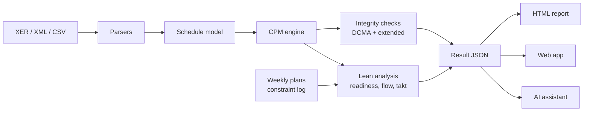

# Lean Schedule Integrity Checker

A free, local tool that checks a construction schedule the way a schedule reviewer would, then
asks the questions a Lean construction coach would. Upload a Primavera P6 (`.xer`), Microsoft
Project (`.xml`) or CSV schedule and get a self-contained HTML report with:

- **Schedule integrity**: the DCMA 14-Point Assessment plus 14 extended CPM checks (dangling
  logic, out-of-sequence progress, loops, redundant links, driving path continuity and more),
  backed by a built-in critical path engine.
- **Lean readiness**: is the schedule ready to run with the Last Planner System? Lookahead
  granularity, responsible trade and location coverage, push constraints, stalled work in
  progress, trade flow, trade stacking and takt balance.
- **Last Planner data**: Percent Plan Complete (PPC), reasons for non-completion, a constraint
  log and a make-ready board, when you add your weekly plans and constraint log.
- **Flow and takt**: a flowline (line-of-balance) chart and a suggested takt plan.
- **A waste lens**: every failed check translated into the eight wastes of Lean.
- **An optional AI planning assistant** that writes the executive summary and answers
  questions, using Azure OpenAI or OpenAI as in the rest of this course.


> Inspired by nPlan's free Schedule Integrity Checker. This project is independent and not
> affiliated with nPlan.

## How nPlan's Schedule Integrity Checker works

[nPlan](https://www.nplan.io/products/schedule-integrity-checker) is a London company whose
main products forecast construction schedule risk with machine learning trained on a large
library of past project schedules. Its free Schedule Integrity Checker
([sic.nplan.io](https://sic.nplan.io/)) is the entry point to that platform. This summary is
based on nPlan's public pages and third-party write-ups; the tool itself was not reachable
from the environment this project was built in.

| Stage | What happens |
|---|---|
| Input | A Primavera P6 (`.xer`) or Asta Powerproject schedule, uploaded in a web browser |
| Processing | nPlan's cloud parses the schedule and runs a battery of integrity checks |
| Checks | Missing or incorrect logic, open ends, negative float, long durations, constraints, lags and leads: the DCMA 14-Point Assessment and checks that go beyond it |
| Output | A report with schedule metrics and the activities behind each finding |
| AI | nPlan's generative AI assistant can interrogate the integrity metrics and draft reports |
| Portfolio | A [portfolio version](https://www.nplan.io/blog-posts/introducing-our-new-portfolio-schedule-integrity-checker) compares integrity across many projects |
| Cost and data | Free to use; the schedule is uploaded to nPlan's cloud, so [reviewers](https://www.plannersplace.com/blog/schedule-integrity-checker) suggest checking your data policy first |

## What this tool adds

| | nPlan Schedule Integrity Checker | This tool |
|---|---|---|
| Inputs | P6 XER, Asta Powerproject | P6 XER, Microsoft Project XML, CSV, plus Last Planner weekly plans and constraint logs |
| Where it runs | nPlan's cloud | Your computer: command line or a local web app. Nothing is uploaded |
| Integrity checks | DCMA 14-Point and beyond | DCMA 14-Point plus 14 extended checks, with its own CPM engine and critical path test |
| Lean construction | Not covered | Last Planner readiness, make-ready board, PPC and reasons for non-completion, flowline, takt plan, trade stacking and continuity, waste lens |
| AI | Built-in assistant | Optional: Azure OpenAI or OpenAI (`gpt-5-mini`), with an offline summary when AI is not configured |
| Output | Web report | One HTML file to share, JSON for other tools, and a `--fail-under` gate for automated checks |

nPlan's core product, risk forecasting from historical schedules, is out of scope here.

## How Lean construction is built in

The checks follow the conversations of the **Last Planner System** (Lean Construction
Institute) from the master schedule down to the daily huddle:

| Last Planner level | What the tool checks |
|---|---|
| Master schedule | CPM integrity: the schedule must be sound before the trades can pull from it (DCMA and extended checks) |
| Phase (pull) planning | Date constraints that push work instead of pulling it, negative float on milestones, driving path continuity |
| Six-week lookahead and make-ready | Tasks small enough to promise in a week, a responsible trade and a location for each task, and a make-ready board that joins the constraint log to the lookahead |
| Weekly work plan | Percent Plan Complete (PPC), PPC by trade, and a Pareto of reasons for non-completion |
| Daily huddle | Slow or stalled work in progress (open work fronts that are not moving) |
| Learning | The waste lens and the AI action plan turn findings into countermeasures |

Constraints and reasons for non-completion are grouped by **Koskela's seven preconditions** of
sound work: information and design, materials, labour, equipment, prerequisite work, space and
access, and external conditions.

**Takt and location-based planning.** Using the trade and location of each activity (P6
activity codes, CSV columns, resources or WBS levels, detected automatically), the tool:

- draws a **flowline**: zones up the side, time across, one line per trade,
- measures **trade stacking** (zone-days with more than one trade) and **trade continuity**
  (idle gaps in each trade's run of work),
- finds the repeating **takt area** (zones that share most trades), measures how evenly each
  trade's work is spread across zones, and suggests a **takt plan**: a balanced takt time,
  the takt train duration, and the crew increase each oversized trade-zone cell would need.


## Quick start

```bash
cd lean-schedule-integrity-checker
pip install -r requirements.txt
```

Check the sample project (a fictional three-storey health centre with problems planted on
purpose):

```bash
python -m lean_sic analyze samples/harbourside-health-centre.xer --weekly-plans samples/weekly-work-plans.csv --constraints samples/constraint-log.csv
```

This prints a summary and writes `samples/harbourside-health-centre-report.html`. Open it in a
browser.

Run the local web app and open the address it prints (port 5000 on your computer). The link
"Open the sample project" loads the sample:

```bash
python -m lean_sic serve
```

### Command reference

| Command | What it does |
|---|---|
| `analyze SCHEDULE` | Check a schedule and write the HTML report. Add `--json results.json` for machine-readable results, `--weekly-plans` and `--constraints` for Last Planner data |
| `fields SCHEDULE` | List the activity codes and columns that can hold trade and location |
| `serve` | Start the local web app (`--host`, `--port`) |
| `ask SCHEDULE "question"` | Ask the AI assistant about a schedule |

Useful options: `--trade-field Trade`, `--location-field Zone` (or `resource`, `wbs`, `wbs:2`),
`--lookahead-weeks 6`, `--data-date 2026-03-02`, `--project SHORTNAME` (XER files with several
projects), `--set high_float_days=30` (any threshold), `--no-web-fonts` (fully offline report)
and `--fail-under 70` (exit with code 1 below that integrity score, for automated quality gates).

### AI planning assistant

The assistant is optional. It uses the same settings as the rest of the course: copy
[.env.copy](../.env.copy?WT.mc_id=academic-105485-koreyst) to `.env` and fill in either
`AZURE_OPENAI_ENDPOINT`, `AZURE_OPENAI_API_KEY` and `AZURE_OPENAI_DEPLOYMENT` (Azure OpenAI in
[Microsoft Foundry](https://ai.azure.com?WT.mc_id=academic-105485-koreyst)), or
`OPENAI_API_KEY`. Then add `--ai` to `analyze`, tick "AI summary" in the web app, or use
`ask`.

How it works, in terms of the course lessons:

- It calls the **Responses API** with `gpt-5-mini`, a reasoning model, so it uses a reasoning
  control and `max_output_tokens` instead of `temperature` (see
  [Building Text Generation Applications](../06-text-generation-apps/README.md?WT.mc_id=academic-105485-koreyst)).
- The system prompt makes it a Lean construction coach and tells it to treat the schedule data
  as data, not instructions ([Securing AI Applications](../13-securing-ai-applications/README.md?WT.mc_id=academic-105485-koreyst)).
- Questions are answered from the analysis plus the activities whose names, trades or zones
  match the question, a small retrieval step ([RAG and Vector Databases](../15-rag-and-vector-databases/README.md?WT.mc_id=academic-105485-koreyst)).
- Only the compact analysis summary is sent to the model, never the schedule file. Without
  AI settings the report uses a rule-based summary, so the tool always works offline.

## Inputs

**Primavera P6 (`.xer`).** Reads projects, calendars (work week and holidays), WBS, activities,
relationships, resources, activity codes and user-defined fields. If the file holds several
projects, the current one is picked automatically (or use `--project`). Export the baseline
project in the same XER to use it as the baseline; otherwise P6 planned dates are used as a
stand-in, which the report states.

**Microsoft Project (`.xml`).** In Microsoft Project choose *File > Save As > XML Format*.
Reads tasks, summary tasks, links, constraints, deadlines, calendars, baseline 0, resources
and custom fields. A custom text field named "Activity ID" is used as the activity ID. Binary
`.mpp` and Asta `.pp` files cannot be read; export to XML or XER.

**CSV schedule.** One row per activity:

```text
# project: Harbourside Health Centre
# data_date: 2026-03-02
# deadline: 2026-08-28
# holidays: 2026-04-03, 2026-04-06
id,name,duration,predecessors,trade,zone,actual_start,actual_finish,baseline_finish
FO-L1A-10,MEP first fix - L1-A,4,K7000SS+10; F4020,MEP,L1-A,2026-02-02,,2026-02-24
```

Required columns are `id` and `name` (plus `duration` and `predecessors` for useful results).
Optional columns include `type`, `status`, `percent_complete`, `remaining_duration`, `start`,
`finish`, `actual_start`, `actual_finish`, `baseline_start`, `baseline_finish`,
`total_float`, `constraint`, `constraint_date`, `deadline`, `wbs` and `resources`. Predecessors
look like `A1010`, `A1020SS+2` or `A1030FF-1d`. Any other column, such as `trade` or `zone`,
is kept as an activity code.

**Weekly work plans (CSV).** One row per weekly commitment:
`week, activity_id, task, trade, planned, completed, reason`.

**Constraint log (CSV).** One row per constraint:
`id, activity_id, description, category, owner, identified, need_by, status, closed`.

See the [samples](./samples/README.md?WT.mc_id=academic-105485-koreyst) for complete examples
and the [checks reference](./docs/checks.md?WT.mc_id=academic-105485-koreyst) for every check,
threshold and scoring rule.

## How it works



| Folder | Contents |
|---|---|
| `lean_sic/parsers` | P6 XER, Microsoft Project XML and CSV readers |
| `lean_sic/cpm.py` | Critical path engine: forward and backward pass, progress, constraints, loops, critical path test |
| `lean_sic/checks` | DCMA 14-Point and extended integrity checks, scoring |
| `lean_sic/lean` | Trade and location mapping, Last Planner data, flow and takt analysis, Lean readiness checks, waste lens |
| `lean_sic/report` | The HTML report (inline SVG charts, no external scripts) |
| `lean_sic/ai.py` | The optional AI planning assistant |
| `lean_sic/web.py` | The local Flask web app |
| `samples` | The fictional sample project and the script that generates it |
| `tests` | The pytest suite (`python -m pytest tests`) |

## Limitations

- Working-day arithmetic uses the project calendar. Activities on other calendars are scaled by
  their days per week, and holidays come from the project calendar only, so recalculated float
  can differ slightly from P6. The report says whether it used stored or recalculated float,
  and check EXT-13 compares the two.
- Lean metrics are only as good as the trade and location coding. When codes are missing,
  the related checks say so instead of guessing.
- The tool reviews schedule quality; it does not forecast risk or replace a planner's review.

## Privacy

Schedules are processed on your computer. The web app keeps uploads in memory only, deletes
them after three hours, and listens on `127.0.0.1` by default; it has no login, so do not
expose it on a shared network. The report loads web fonts from Google Fonts unless you pass
`--no-web-fonts`.
